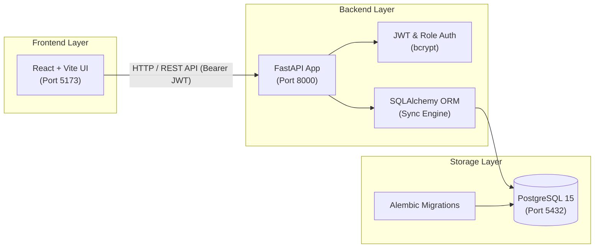

# FaceMark — Attendance System (Phase 1)

FaceMark is a face-recognition-ready attendance and student management system designed for tuition centers and coaching institutes.

This repository implements **Phase 1: Core System Architecture and Management Infrastructure**. It establishes the complete normalized database schema, synchronous SQLAlchemy ORM models, Alembic migrations, JWT authentication with Role-Based Access Control (Admin and Teacher), CRUD APIs, and an interactive React frontend.

> [!NOTE]
> Face recognition logic and camera capture are intentionally scoped for Phase 2. The database schema in Phase 1 already includes the `face_embeddings`, `attendance_sessions`, and `attendance_records` tables with all constraints and cascades configured.

---

## 1. System Architecture & Tech Stack



* **Backend**: FastAPI (Python 3.11), Synchronous SQLAlchemy 2.x, Pydantic v2, PyJWT, `bcrypt==4.0.1`
* **Frontend**: React 18, Vite, React Router v6, Axios, Lucide Icons
* **Database**: PostgreSQL 15, Alembic Database Migrations
* **Deployment**: Docker & Docker Compose multi-container orchestration

---

## 2. Database Schema (7 Normalized Tables)

All primary keys use auto-incrementing **Integers**.

1. **`users`**:
   - `id` (PK, Integer), `email` (Unique, Indexed), `hashed_password` (bcrypt), `full_name`, `role` (`admin` or `teacher`), `is_active`, `created_at`.
2. **`students`**:
   - `id` (PK, Integer), `roll_number` (Unique, Indexed), `full_name`, `email`, `phone`, `is_active`, `created_at`.
3. **`batches`**:
   - `id` (PK, Integer), `name` (e.g. *Class 10 - Mathematics*), `subject`, `description`, `created_at`.
4. **`enrollments`**:
   - `id` (PK, Integer), `student_id` (FK `students.id` `ON DELETE CASCADE`), `batch_id` (FK `batches.id` `ON DELETE CASCADE`), `enrolled_at`.
   - `UNIQUE(student_id, batch_id)` prevents double enrollment.
5. **`face_embeddings`** *(Phase 2 ready)*:
   - `id` (PK, Integer), `student_id` (FK `students.id` `ON DELETE CASCADE`), `embedding_data` (JSON list of floats, e.g. 128-d / 512-d feature vectors), `created_at`.
   - **Privacy design**: No raw photo images are stored in the database.
6. **`attendance_sessions`**:
   - `id` (PK, Integer), `batch_id` (FK `batches.id` `ON DELETE CASCADE`), `taken_by_user_id` (FK `users.id` `ON DELETE SET NULL`), `session_date` (Date), `status` (`completed`), `created_at`.
7. **`attendance_records`**:
   - `id` (PK, Integer), `session_id` (FK `attendance_sessions.id` `ON DELETE CASCADE`), `student_id` (FK `students.id` `ON DELETE CASCADE`), `status` (`present`, `absent`, `late`), `confidence_score` (Float, nullable), `marked_at`.
   - `UNIQUE(session_id, student_id)` prevents duplicate marks per session.

---

## 3. Quickstart with Docker Compose

### Prerequisites
* Docker & Docker Compose installed and running.

### Steps

1. **Copy the environment configuration**:
   ```bash
   cp .env.example .env
   ```

2. **Start all services**:
   ```bash
   docker compose up --build
   ```

3. **What happens automatically**:
   - PostgreSQL container starts and performs health check.
   - Backend waits for DB, runs Alembic migrations (`alembic upgrade head`).
   - Backend automatically seeds default **Admin**, **Teacher**, demo batches, and students via `seed.py`.
   - Frontend starts Vite development server on port `5173`.

4. **Access the Applications**:
   * **Frontend UI**: [http://localhost:5173](http://localhost:5173)
   * **Backend API Docs (Swagger UI)**: [http://localhost:8000/docs](http://localhost:8000/docs)
   * **Backend ReDoc**: [http://localhost:8000/redoc](http://localhost:8000/redoc)
   * **API Healthcheck**: [http://localhost:8000/health](http://localhost:8000/health)

---

## 4. Default Seed Credentials

For quick evaluation and viva demonstrations, the login screen includes **one-click quick-fill buttons**:

| Role | Email | Password | Privileges |
| :--- | :--- | :--- | :--- |
| **Admin** | `admin@facemark.local` | `admin123` | Full access: create/edit/delete students & batches |
| **Teacher** | `teacher@facemark.local` | `teacher123` | Can view students/batches, create students/batches, and enroll students |

---

## 5. Running Locally (Without Docker)

If you wish to run the project directly on your host machine:

### 1. Database Setup
Ensure PostgreSQL is running locally on port `5432` with a database named `facemark_db`.

### 2. Backend Setup
```bash
cd backend

# Create and activate virtual environment
python -m venv venv
# Windows:
venv\Scripts\activate
# Linux/macOS:
source venv/bin/activate

# Install dependencies
pip install -r requirements.txt

# Configure environment variables (or copy .env.example to .env and adjust DATABASE_URL)
# Run Alembic migrations
alembic upgrade head

# Seed initial database
python seed.py

# Start FastAPI server
uvicorn app.main:app --host 0.0.0.0 --port 8000 --reload
```

### 3. Frontend Setup
```bash
cd frontend

# Install Node dependencies
npm install

# Start Vite dev server
npm run dev
```
Open [http://localhost:5173](http://localhost:5173) in your browser.

---

## 6. Project Directory Layout

```text
facemark/
├── .env.example               # Template environment configuration
├── .gitignore                 # Excludes .env, node_modules, __pycache__
├── docker-compose.yml         # 3 services: db, backend, frontend
├── README.md                  # Complete documentation and viva guide
├── backend/
│   ├── Dockerfile
│   ├── requirements.txt
│   ├── alembic.ini
│   ├── seed.py                # Idempotent seed data generator
│   ├── alembic/
│   │   ├── env.py             # Configures metadata and runtime DB connection
│   │   ├── script.py.mako
│   │   └── versions/
│   │       └── 0001_initial_schema.py # Initial migration script
│   └── app/
│       ├── main.py            # FastAPI entry point & CORS configuration
│       ├── core/
│       │   ├── config.py      # Pydantic settings loading from .env
│       │   ├── database.py    # Synchronous SQLAlchemy engine & get_db dependency
│       │   └── security.py    # Direct bcrypt hashing and JWT encoding/decoding
│       ├── models/            # SQLAlchemy ORM declarative models
│       │   ├── user.py        # User & UserRole enum
│       │   ├── student.py     # Student & FaceEmbedding
│       │   ├── batch.py       # Batch & Enrollment
│       │   └── attendance.py  # AttendanceSession & AttendanceRecord
│       ├── schemas/           # Pydantic request/response validation schemas
│       │   ├── token.py
│       │   ├── user.py
│       │   ├── student.py
│       │   └── batch.py
│       └── api/
│           ├── deps.py        # Auth & Role verification dependencies
│           └── v1/
│               ├── auth.py    # /api/v1/auth/login and /api/v1/auth/me
│               ├── students.py# /api/v1/students CRUD endpoints
│               └── batches.py # /api/v1/batches and enrollment endpoints
└── frontend/
    ├── Dockerfile
    ├── nginx.conf
    ├── package.json
    ├── vite.config.js
    ├── index.html
    └── src/
        ├── main.jsx
        ├── index.css          # Clean, responsive CSS styling
        ├── App.jsx            # React Router and protected routes
        ├── api/
        │   └── client.js      # Axios instance with Bearer token interceptor
        ├── context/
        │   └── AuthContext.jsx# React Context for auth state & role checking
        ├── components/
        │   ├── Navbar.jsx
        │   ├── Sidebar.jsx
        │   └── ProtectedRoute.jsx
        └── pages/
            ├── Login.jsx      # Login page with quick-fill buttons
            ├── Dashboard.jsx  # Metrics and viva architecture summary
            ├── Students.jsx   # Student table, search, and CRUD modal
            └── Batches.jsx    # Batch table and student enrollment modal
```

---

## 7. Viva / Academic Presentation Guide

Here are explanations of key architectural choices frequently asked by examiners:

### Q1: Why separate SQLAlchemy Models from Pydantic Schemas?
* **SQLAlchemy Models** (`app/models/`) define the **database structure** (tables, columns, foreign keys, indexes, cascades). They handle database persistence.
* **Pydantic Schemas** (`app/schemas/`) define the **data transfer contracts** (API request payloads and response shapes). They handle input validation, type coercion, and security (e.g. omitting `hashed_password` when returning user data).

### Q2: How does Role-Based Access Control (RBAC) work in this project?
* When a user logs in (`/api/v1/auth/login`), their email and role (`admin` or `teacher`) are encoded inside the cryptographically signed JWT payload.
* Protected endpoints use FastAPI dependency injection (`Depends(get_current_user)`).
* Sensitive operations like deleting students or batches inject `Depends(require_admin)`, which checks `current_user.role == 'admin'` and returns HTTP 403 Forbidden if violated.

### Q3: Why use bcrypt directly instead of passlib?
* Recent Python releases (e.g., Python 3.12+) encountered compatibility warnings and deprecations with `passlib`. Using `bcrypt` directly with `bcrypt.hashpw` and `bcrypt.checkpw` provides reliable, future-proof password security without extra wrapper overhead.

### Q4: Why use Alembic migrations instead of `Base.metadata.create_all()`?
* `create_all()` only creates tables if they do not exist; it **cannot alter** existing columns, add constraints, or rollback changes.
* Alembic provides **version control for database schemas**, enabling tracking, upgrading, and rolling back migrations across different development and production environments.

### Q5: Why store face embeddings as JSON float lists instead of storing images on disk?
* Storing raw images requires disk storage, backups, and poses privacy/GDPR concerns.
* Modern face recognition models extract mathematical vectors (e.g. 128 or 512 numerical floats) that represent facial landmarks. Storing these vectors directly in PostgreSQL enables fast cosine-distance comparison in Phase 2 without needing the original photo.
