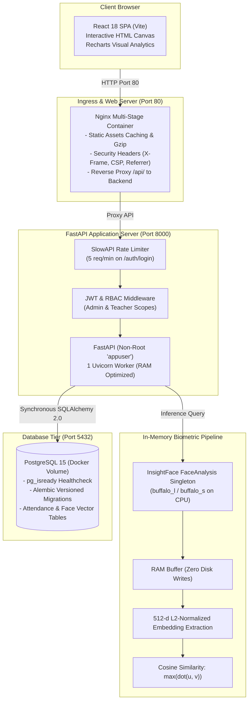

# AttendIQ— Attendance System (Phase 1, Phase 2, Phase 3 & Phase 4)

[](https://github.com/facemark/facemark/actions/workflows/ci.yml)


FaceMark is a modern, privacy-first face-recognition attendance and student management system designed for tuition centers and coaching institutes.

* **Phase 1: Core System Architecture & Management Infrastructure**: Normalized PostgreSQL schema (7 tables), synchronous SQLAlchemy 2.x ORM, Alembic migrations, JWT authentication with Role-Based Access Control (Admin and Teacher), CRUD APIs, and React UI.
* **Phase 2: Face Enrollment & Recognition Engine**: Zero-disk-storage biometric pipeline powered by InsightFace (`buffalo_l`), L2-normalized 512-dimensional embeddings, vector cosine similarity matching via NumPy dot products, student consent enforcement ("Consent to store face data"), batch-level RBAC for teachers, and precision/recall evaluation tooling.
* **Phase 3: Attendance Review Flow & Reports**: Interactive attendance workflow with canvas bounding box overlays (Green=matched, Amber=review, Red=unknown), manual override roster, assignment of unknown faces, session creation with duplicate date protection (`UNIQUE(batch_id, session_date)`), confirmed status persistence, Recharts visual analytics, low-attendance alerts ($< 75\%$), and CSV report export.
* **Phase 4: Quality, DevOps & Security Hardening**: Comprehensive test suite with $\ge 70\%$ backend coverage (`pytest-cov`), frontend Vitest smoke testing and ESLint enforcement, multi-stage production Docker setup served by Nginx with security headers, non-root user execution, single-worker memory optimization for InsightFace, SlowAPI rate limiting on authentication, GitHub Actions CI/CD to GitHub Container Registry (GHCR), and complete cloud VM deployment guide (`DEPLOYMENT.md`).

---

## 1. System Architecture & Attendance Workflow



---

## 2. Attendance Canvas Bounding Box Color Codes

When a group classroom photo is analyzed during attendance capture:
1. 🟢 **Green Box** (`matched` &ge; 0.45): High-confidence biometric match. Displays student full name, roll number, and match percentage (e.g. `Aarav Patel (92%)`). Automatically pre-fills student as **Present** in the roster.
2. 🟠 **Amber Box** (`review` 0.35 &ndash; 0.45): Potential match flagged for teacher confirmation. Displays candidate name and match percentage.
3. 🔴 **Red Box** (`unknown` &lt; 0.35): Unidentified person or visitor. Can be assigned to any absent enrolled student via the dropdown in the side review panel.

> [!IMPORTANT]
> **Privacy Guarantee**: The classroom photograph exists solely in browser memory (`URL.createObjectURL`) and ephemeral backend RAM during inference. Photos are never stored on disk or in the database.

---

## 3. Database Schema & Alembic Migrations

All tables use auto-incrementing **Integer** primary keys.

```text
users (id, email, hashed_password, full_name, role, is_active, created_at)
  │
  ├─ batches (id, name, subject, description, teacher_id -> users.id, created_at)
  │    │
  │    ├─ enrollments (id, student_id -> students.id, batch_id -> batches.id, enrolled_at)
  │    │
  │    └─ attendance_sessions (id, batch_id, taken_by_user_id, session_date, status, unrecognized_count, created_at)
  │         │   └─ UNIQUE(batch_id, session_date) [Migration 0004]
  │         │
  │         └─ attendance_records (id, session_id, student_id, status, method, is_confirmed, confidence_score, marked_at)
  │              └─ UNIQUE(session_id, student_id)
  │
students (id, roll_number, full_name, email, phone, is_active, consent_given, consent_at, created_at)
  │
  └─ face_embeddings (id, student_id ON DELETE CASCADE, embedding_data JSON, created_at)
```

### Alembic Migration History
1. `0001_initial_schema`: Initial normalized schema (7 tables).
2. `0002_batch_teacher_attendance`: Added `batches.teacher_id`, `attendance_records.method`, `attendance_records.is_confirmed`, and `attendance_sessions.unrecognized_count`.
3. `0003_student_face_consent`: Added `students.consent_given` (Boolean, default False) and `students.consent_at`.
4. `0004_session_batch_date_unique`: Added `UniqueConstraint('batch_id', 'session_date', name='uq_batch_date')` to `attendance_sessions` ensuring one session per batch per date.

---

## 4. Phase 3 API Reference

All endpoints require JWT Bearer authentication.

### Attendance Session Endpoints (`/api/v1/attendance`)
| Method | Endpoint | Access | Description |
| :--- | :--- | :--- | :--- |
| `POST` | `/attendance/recognize` | Teacher (Own) / Admin | Analyzes group photo; returns upright dimensions, bounding boxes, statuses, confidence scores, and absent student IDs. |
| `POST` | `/attendance/sessions` | Teacher (Own) / Admin | Creates session (`batch_id`, `session_date`). Strictly enforces unique session per batch per date (HTTP 409 if duplicate). |
| `POST` | `/attendance/sessions/{id}/confirm` | Teacher (Own) / Admin | Confirms attendance records (`student_id`, `status: present/absent/late`, `method: face/manual`, `confidence_score`). Sets `is_confirmed=true`, updates `unrecognized_count`, and marks `status='completed'`. Rejects duplicate students in payload (HTTP 400). |
| `GET` | `/attendance/sessions` | Teacher (Own) / Admin | Lists attendance sessions with counts, filterable by `batch_id`, `from_date`, and `to_date`. |
| `GET` | `/attendance/sessions/{id}` | Teacher (Own) / Admin | Retrieves session details and student attendance records. |

### Reports & Analytics Endpoints (`/api/v1/reports`)
| Method | Endpoint | Access | Description |
| :--- | :--- | :--- | :--- |
| `GET` | `/reports/student/{id}` | Teacher (Enrolled) / Admin | Returns student attendance % overall and per-batch breakdown. Flags `is_low_attendance=true` if &lt; 75%. |
| `GET` | `/reports/batch/{id}?from=&to=` | Teacher (Own) / Admin | Computes per-student counts and %, identifies low-attendance students, and generates daily trend timeline for Recharts. |
| `GET` | `/reports/batch/{id}/export` | Teacher (Own) / Admin | Downloads CSV file of batch attendance report (`text/csv`). |
| `GET` | `/reports/dashboard` | All Authenticated | Provides today's attendance summary (sessions, present, absent, rate) and low-attendance students across active batches. |

---

## 5. Attendance Calculation & Alert Threshold

* **Attendance Percentage Formula**:
  $$\text{Attendance Rate (\%)} = \left( \frac{\text{Present Count} + \text{Late Count}}{\text{Total Sessions}} \right) \times 100$$
* **Low-Attendance Alert Threshold**:
  Configured via `ATTENDANCE_ALERT_THRESHOLD=75.0` (default 75%).
  Any student with attendance rate strictly below 75% is automatically flagged with `is_low_attendance: true` and surfaced in the Dashboard and Reports warning widgets.

---

## 6. Running the Application & Tests

### Start Services in Development Mode
```bash
cd facemark
docker compose up --build
```

### Start Services in Hardened Production Mode
```bash
cd facemark
docker compose -f docker-compose.prod.yml up -d --build
```

### Run All Backend Tests with Coverage (>= 70%)
In a separate terminal:
```bash
# Run full test suite with coverage report (fails if under 70%):
docker compose exec backend pytest --cov=app --cov-report=term-missing --cov-fail-under=70 -v

# Run individual test suites:
docker compose exec backend pytest tests/test_auth_and_users.py -v
docker compose exec backend pytest tests/test_students_crud_and_security.py -v
docker compose exec backend pytest tests/test_attendance_and_reports.py -v
docker compose exec backend pytest tests/test_face_engine_endpoints.py -v
docker compose exec backend pytest tests/test_batches_rbac.py -v
```

### Run Frontend Linting & Smoke Tests
```bash
# Run ESLint check
docker compose exec frontend npm run lint

# Run Vitest smoke tests
docker compose exec frontend npm test
```

---

## 7. Academic Viva / Presentation Q&A (Phase 4)

### Q1: Why must the production backend run with only ONE Uvicorn worker?
* The biometric recognition engine (`InsightFace` / `ONNX Runtime`) loads multiple deep convolutional neural network weights (RetinaFace for detection, ArcFace for 512-d feature extraction).
* Each Uvicorn worker operates in an isolated OS process. If Uvicorn runs with 4 workers (`--workers 4`), the entire model (~350MB weights + ~1.2GB runtime memory) is loaded 4 times independently, consuming over 5 GB of RAM.
* Restricting production to **1 Uvicorn worker** (`--workers 1`) bounds memory consumption strictly to ~1.5 GB RAM, allowing the system to run reliably on single-node budget cloud VMs without triggering OOM (Out-Of-Memory) killer terminations.

### Q2: Why run containerized services as a non-root user (`appuser`)?
* By default, Docker containers run processes as root (UID 0). If a vulnerability exists in any dependency (e.g. image processing or file parsing libraries), an attacker exploiting remote code execution gains root privileges inside the container, increasing the risk of container escape and host kernel exploitation.
* Creating and switching to a dedicated non-root user (`USER appuser`) ensures the principle of least privilege, preventing unauthorized system configuration changes and file tampering.

### Q3: Why is rate limiting placed specifically on `/api/v1/auth/login`?
* Authentication endpoints are the primary target for credential stuffing, dictionary attacks, and automated brute-force attempts.
* SlowAPI rate limits `/api/v1/auth/login` to `5 requests/minute` per client IP. This denies automated password guessing while having zero impact on regular school staff and teachers.

### Q4: When and why should an administrator switch to `MODEL_NAME=buffalo_s`?
* `buffalo_s` is a lightweight, mobile-optimized InsightFace model (~85 MB) designed for resource-constrained environments.
* When hosting FaceMark on budget cloud servers with 1GB to 2GB RAM (e.g. \$4&ndash;\$6/mo VMs), setting `MODEL_NAME=buffalo_s` reduces inference RAM by ~65% (~500MB total), ensuring snappy attendance recognition without requiring expensive multi-gigabyte cloud instances.
